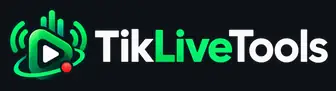
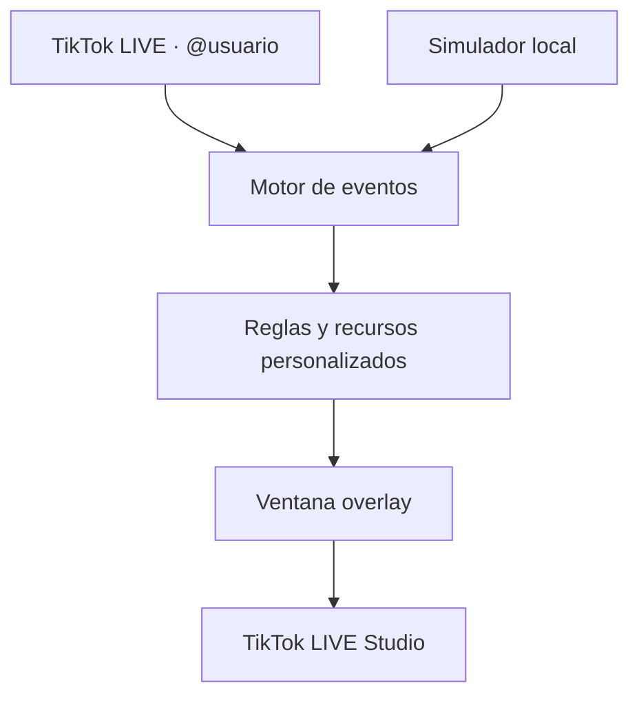

<div align="center">



**Tu LIVE. Tus alertas. Tu estilo.**

Personaliza alertas, animaciones y recursos multimedia para TikTok LIVE Studio.

**Windows 10/11 x64 · Portable · Gratuito · Sin inicio de sesión**

<a href="https://github.com/Destruct0rx/TikLiveTools-Releases/releases"></a>
<a href="https://tiklivetools.ultimares.store/"></a>

[Descargas](#descargas) · [Funciones](#funciones) · [Primeros pasos](#primeros-pasos) · [Ayuda](#ayuda)

</div>

---

## Descargas

**Estado del proyecto: en desarrollo.** Si todavía no existe una publicación estable con un ZIP portable adjunto, la descarga estable aún no está disponible. Las notas de cada versión identificarán sus funciones verificadas y limitaciones.

| Plataforma | Distribución |
| :--- | :--- |
| Windows 10/11 de 64 bits | ZIP portable, sin instalador |

[**Consultar versiones oficiales →**](https://github.com/Destruct0rx/TikLiveTools-Releases/releases)

Busca un archivo adjunto con el formato `TikLiveTools-Portable-vX.Y.Z-win-x64.zip`. Es un ejemplo de nombre, no una versión disponible. No confundas el portable con los archivos automáticos **Source code (zip)** o **Source code (tar.gz)** ni una versión preliminar con una estable.

## Funciones

TikLiveTools está diseñado para convertir eventos compatibles de TikTok LIVE en alertas personalizadas, sin exigir OBS, una suscripción o una cuenta de TikLiveTools. Cada creador puede elegir su propia identidad visual.

### Cinco áreas de trabajo

| Área | Función prevista |
| :--- | :--- |
| **Inicio** | Estado de conexión, actividad y resumen de la sesión. |
| **Alertas** | Regalos, monedas, rachas, stickers y demás eventos compatibles. |
| **Animaciones** | Recursos para eventos de comunidad y combinaciones de roles. |
| **Simulador** | Pruebas de eventos y alertas antes de transmitir. |
| **Ajustes** | Conexión mediante @usuario, overlay y diagnóstico. |

### Personalización y recursos

| Herramienta | Funcionamiento previsto |
| :--- | :--- |
| Biblioteca de regalos | Búsqueda, imágenes, favoritos y reglas individuales o por valor en monedas. |
| Comunidad | Seguidores, moderadores, suscriptores y Super Fans. |
| Biblioteca multimedia | Organizar GIF, imágenes, videos y audio propios. |
| Estudio 9:16 | Composición por capas, texto dinámico, posiciones, escalado y zonas seguras. |
| Sonido y video | Audio independiente, reproducción de GIF o video y TTS sujeto a compatibilidad. |
| Overlay | Ventana dedicada capturable desde TikTok LIVE Studio. |

<details>
<summary><strong>Ver los ocho eventos de animaciones</strong></summary>

| Evento | Regla prevista |
| :--- | :--- |
| Follow | Nuevo seguidor. |
| Moderador | Rol de moderador. |
| Suscriptor | Rol de suscriptor. |
| Super Fan | Rol Super Fan. |
| Mod + Sub | Combinación de moderador y suscriptor. |
| Mod + Super Fan | Combinación de moderador y Super Fan. |
| Sub + Super Fan | Combinación de suscriptor y Super Fan. |
| Triple VIP | Los tres roles combinados. |

Cada combinación tendrá su propia asignación, evitando duplicar alertas. La recepción efectiva de eventos y roles depende de los datos disponibles en el conector y de la versión publicada.

</details>

### Cómo funciona



Flujo previsto del programa. La página oficial informa y distribuye; la ejecución y configuración corresponden al programa de escritorio.

## Primeros pasos

1. **Descarga y extrae.** Selecciona una publicación estable, revisa los requisitos y extrae todo el ZIP en una carpeta local con permisos de escritura.
2. **Ejecuta.** Abre el programa siguiendo las instrucciones de esa versión.
3. **Conecta tu LIVE.** Introduce tu nombre de usuario, por ejemplo `@tuusuario`, y establece la conexión cuando tu transmisión esté activa. Comprueba el estado de conexión.
4. **Personaliza.** Asigna recursos, sonidos y reglas a los eventos disponibles.
5. **Prueba.** Utiliza el simulador antes de emitir las alertas.
6. **Transmite.** Abre el overlay y captura su ventana en TikTok LIVE Studio.

No necesitas entregar tu contraseña, registrar una cuenta ni autorizar OAuth. La conexión por nombre de usuario no proporciona acceso administrativo a tu cuenta de TikTok. Se requiere Internet para recibir eventos.

[**Consultar documentación completa →**](https://tiklivetools.ultimares.store/)

## Actualizaciones e integridad

Cada publicación estable deberá identificar los cambios, requisitos, limitaciones y el archivo portable correspondiente. Respalda tus configuraciones y recursos personales antes de actualizar y sigue las instrucciones de migración de la publicación.

<details>
<summary><strong>Verificar el SHA-256 en Windows</strong></summary>

Si la publicación proporciona un SHA-256, abre PowerShell en la carpeta del archivo descargado:

```powershell
Get-FileHash -Algorithm SHA256 -LiteralPath ".\TikLiveTools-Portable-vX.Y.Z-win-x64.zip"
```

Sustituye el nombre de ejemplo por el archivo real y compara el resultado con el hash publicado. Si no coincide, no ejecutes el contenido. El hash comprueba integridad respecto de un valor de referencia; no sustituye una firma digital.

</details>

## Ayuda

<details>
<summary><strong>No encuentro una descarga estable</strong></summary>

Consulta [Releases](https://github.com/Destruct0rx/TikLiveTools-Releases/releases). Si todavía no hay una publicación estable con el ZIP portable adjunto, aún no existe una descarga estable disponible.

</details>

<details>
<summary><strong>No conecta o no recibe eventos</strong></summary>

Comprueba el @usuario, Internet, el estado de tu LIVE y la compatibilidad de los eventos con tu versión. Revisa el diagnóstico del programa.

</details>

<details>
<summary><strong>¿Necesito OBS, una cuenta o pagar?</strong></summary>

No se requiere OBS, registro ni una suscripción de TikLiveTools. El proyecto prevé la captura del overlay desde TikTok LIVE Studio.

</details>

<details>
<summary><strong>¿Puedo usar mis propios GIF, videos y sonidos?</strong></summary>

Sí, forma parte del alcance del programa. Consulta los formatos y límites de la versión publicada.

</details>

<details>
<summary><strong>¿Cómo informo de un error?</strong></summary>

Indica la versión de TikLiveTools, la versión de Windows, los pasos para reproducir el problema y el mensaje de error. No compartas contraseñas, cookies, tokens ni datos personales en informes públicos. Consulta las indicaciones de soporte de la web oficial.

</details>

---

<div align="center">

[**Web oficial**](https://tiklivetools.ultimares.store/) · [**GitHub Releases**](https://github.com/Destruct0rx/TikLiveTools-Releases/releases)

Proyecto independiente, no afiliado a TikTok. Este repositorio distribuye el portable; no contiene su código fuente.

</div>
