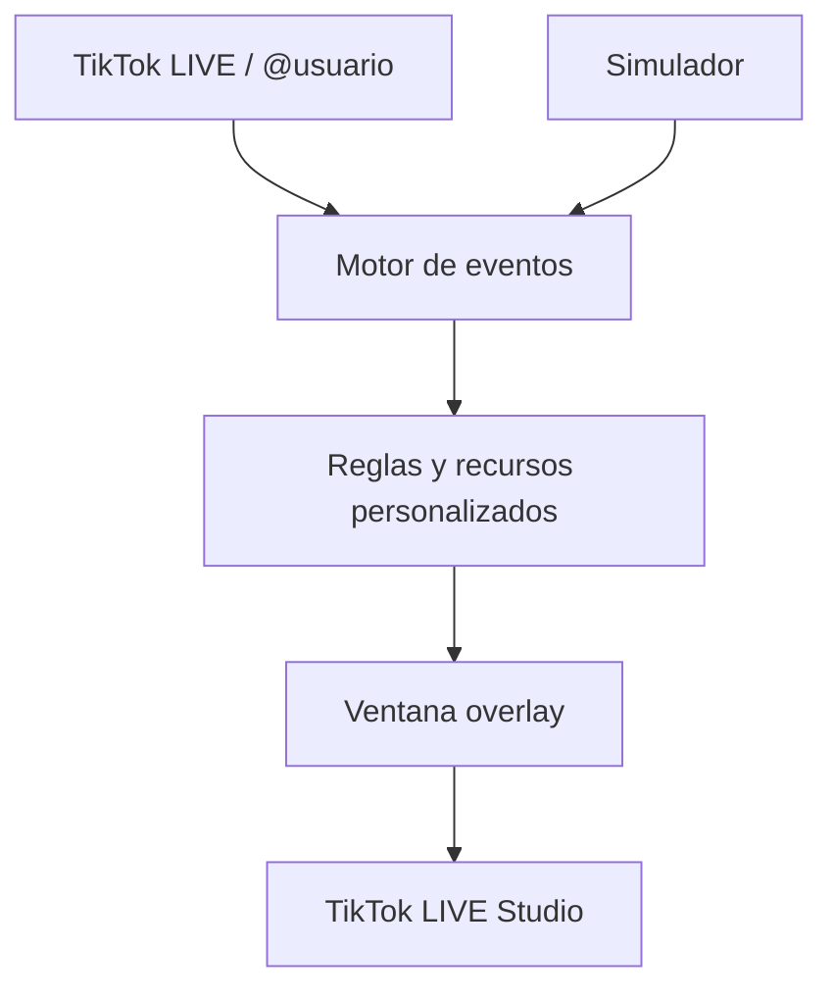

<div align="center">

# TikLiveTools

### Personaliza tu TikTok LIVE. A tu manera.

Herramienta de escritorio portable para crear alertas, animaciones y overlays personalizados para TikTok LIVE Studio.

**Windows 10 / 11 · 64 bits · Gratuito · Sin inicio de sesión**

[**Página oficial**](https://tiklivetools.ultimares.store/) &nbsp;·&nbsp; [**Versiones y descargas**](https://github.com/Destruct0rx/TikLiveTools-Releases/releases) &nbsp;·&nbsp; [**Documentación y ayuda**](https://tiklivetools.ultimares.store/)

</div>

---

> [!NOTE]
> **Estado del proyecto: en desarrollo.** Este es el repositorio oficial de distribución. Las funciones descritas forman parte del alcance del programa; las notas de cada versión indicarán cuáles están disponibles y verificadas. Si todavía no existe un ZIP portable en una publicación estable, no hay una descarga estable disponible.

## ¿Qué es TikLiveTools?

TikLiveTools está pensado para creadores que desean controlar cómo se presentan los eventos de sus transmisiones sin depender de herramientas de pago, de OBS ni de un inicio de sesión en TikLiveTools.

La idea es sencilla: conectar tu LIVE mediante tu **@usuario de TikTok**, personalizar las reglas y recursos de cada evento, comprobar el resultado antes de transmitir y capturar el overlay en TikTok LIVE Studio.

### Un programa, cinco áreas de trabajo

| Área | Qué podrás hacer |
| :--- | :--- |
| **Inicio** | Consultar el estado de conexión, la actividad y el resumen de la sesión. |
| **Alertas** | Configurar regalos, monedas, rachas, stickers y otros eventos compatibles. |
| **Animaciones** | Personalizar eventos de comunidad y combinaciones de roles. |
| **Simulador** | Probar las alertas y sus recursos antes de emitir en directo. |
| **Ajustes** | Configurar la conexión, el overlay y las opciones de diagnóstico. |

### Personalización a tu medida

| Función prevista | Descripción |
| :--- | :--- |
| Regalos y rachas | Reglas individuales o compartidas por valor en monedas. |
| Comunidad | Seguidores, moderadores, suscriptores, Super Fans y sus combinaciones de roles. |
| Biblioteca multimedia | Organización de GIF, imágenes, videos y audio propios. |
| Estudio vertical 9:16 | Composición por capas, texto, posiciones, escalado y zonas seguras. |
| Audio y alertas | Recursos visuales y audio independientes; TTS en español sujeto a compatibilidad. |
| Overlay | Ventana dedicada para capturar en TikTok LIVE Studio. |

Cada creador podrá elegir su propia identidad visual. Las animaciones y recursos no están limitados a un personaje o estilo específico.

## Cómo funciona



El esquema representa el flujo previsto del programa. La compatibilidad efectiva de los eventos depende de la versión publicada y del estado del servicio de TikTok.

## Descargas oficiales

[**Consultar todas las versiones de TikLiveTools**](https://github.com/Destruct0rx/TikLiveTools-Releases/releases)

| Requisito o característica | Información |
| :--- | :--- |
| Sistema operativo objetivo | Windows 10 / 11 |
| Arquitectura | x64 (64 bits) |
| Distribución | Archivo ZIP portable |
| Precio | Gratuito |
| Registro o autenticación | No requerido |
| OBS | No obligatorio |
| Conexión a Internet | Necesaria para recibir eventos del LIVE |
| Otros requisitos | Consultar las notas de la versión |

Busca un archivo adjunto con un nombre como:

```text
TikLiveTools-Portable-vX.Y.Z-win-x64.zip
```

El nombre anterior es un ejemplo del formato de publicación, no una versión disponible.

> [!IMPORTANT]
> No descargues los archivos automáticos **Source code (zip)** o **Source code (tar.gz)** pensando que son el programa. El portable se publicará como archivo adjunto de una release estable.

## Primeros pasos

1. **Descarga:** elige una publicación estable y revisa sus requisitos y limitaciones.
2. **Extrae:** descomprime el ZIP completo en una carpeta local donde tengas permisos de escritura.
3. **Ejecuta:** abre el programa siguiendo las instrucciones de esa publicación.
4. **Conecta:** introduce el nombre de usuario de TikTok, por ejemplo `@tuusuario`, en el apartado de conexión. Inicia tu LIVE cuando corresponda y comprueba el estado de conexión.
5. **Personaliza:** asigna tus animaciones, sonidos y reglas a los eventos compatibles.
6. **Prueba y transmite:** comprueba las alertas en el simulador y captura la ventana de overlay desde TikTok LIVE Studio.

Los nombres de botones y los pasos exactos se documentarán conforme se verifique la interfaz de cada versión.

## Actualizaciones e integridad

Las publicaciones estables incluirán notas de cambios, requisitos y limitaciones. Conserva una copia de tus configuraciones y archivos multimedia antes de actualizar y sigue las instrucciones de migración de la versión correspondiente.

### Verificar el SHA-256 en Windows

Si la publicación proporciona un SHA-256, puedes comprobar el archivo descargado desde PowerShell:

```powershell
Get-FileHash -Algorithm SHA256 -LiteralPath ".\TikLiveTools-Portable-vX.Y.Z-win-x64.zip"
```

Sustituye el nombre del ejemplo por el del archivo descargado y compara el resultado con el hash oficial. Si no coinciden, no ejecutes el contenido y vuelve a descargarlo desde una fuente oficial.

El hash permite comparar la integridad con un valor de referencia; no sustituye una firma digital.

## Preguntas frecuentes

<details>
<summary><strong>¿Necesito iniciar sesión con TikTok?</strong></summary>

No. El diseño del programa contempla la conexión al LIVE mediante @usuario, sin OAuth, contraseña ni registro en TikLiveTools. Eso no equivale a obtener acceso administrativo a tu cuenta.

</details>

<details>
<summary><strong>¿Necesito OBS o una suscripción de pago?</strong></summary>

No se requiere OBS ni una suscripción de TikLiveTools. La integración prevista se realiza mediante una ventana de overlay capturable en TikTok LIVE Studio.

</details>

<details>
<summary><strong>¿Puedo usar mis propios GIF, videos y sonidos?</strong></summary>

Sí, la personalización multimedia forma parte del alcance. Consulta los formatos y límites que admita la versión que descargues.

</details>

<details>
<summary><strong>¿Por qué no encuentro una descarga estable?</strong></summary>

Si no existe una publicación estable con un ZIP portable adjunto, el programa aún no está disponible para descarga estable desde este repositorio. Las versiones preliminares no equivalen a una versión estable.

</details>

<details>
<summary><strong>¿Qué hago si no llegan los eventos del LIVE?</strong></summary>

Comprueba el @usuario, la conexión a Internet, que la transmisión esté activa y los eventos admitidos por tu versión. Consulta la documentación y las limitaciones conocidas.

</details>

## Documentación y soporte

Visita [tiklivetools.ultimares.store](https://tiklivetools.ultimares.store/) para conocer el programa, las guías de conexión, la configuración de alertas, el overlay y las preguntas frecuentes.

Cuando informes de un problema, indica la versión del programa, tu versión de Windows, los pasos para reproducirlo y el mensaje de error. No compartas contraseñas, cookies, tokens ni datos personales en informes públicos.

---

<div align="center">

**TikLiveTools**

[Web oficial](https://tiklivetools.ultimares.store/) &nbsp;·&nbsp; [GitHub Releases](https://github.com/Destruct0rx/TikLiveTools-Releases/releases)

Proyecto independiente, no afiliado a TikTok. Este repositorio está destinado a la distribución del portable; no contiene su código fuente.

</div>
